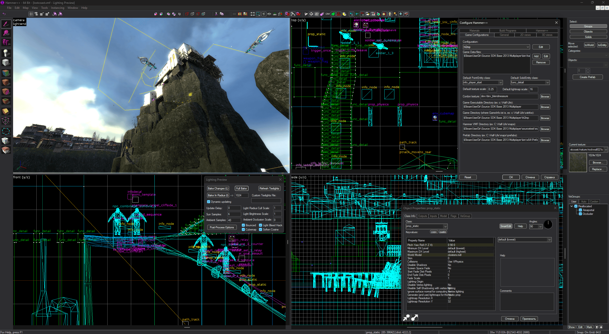

<p align="center"></p>

English Version | [Русская версия](README_ru.md)

## Installation

**Hammer++ must be closed.**

1. Run **hppxdark_setup.exe**;
2. Open the game `bin` folder, via **Browse...** or drop it on the window;
3. Press **Patch**;

## Showcase


<p align="center">Hammer++ - dark theme</p>

## Configuration

The `hppxdark.ini` file next to `hppxdark.dll`, in `hammerplusplus\bin`:

```ini
[DarkTheme]
Enabled=1    ; 0 - light theme / 1 - custom dark theme
```

### Palette

Dark theme colors are set in the `[Palette]` section, as `#RRGGBB` or `R,G,B`.

*Every key is optional: missing ones keep their defaults, and a value that can't be parsed is not applied (a build with `HPPXDARK_LOG` notes it in the log).*

```ini
[Palette]
Face=#2D2D30
Text=220,220,220
```

| Key | Default | Used for |
|-|-|-|
| `Face` | `45,45,48` | background of panels, dialogs, buttons, toolbars, splitters |
| `Window` | `30,30,30` | background of lists, trees, views; unselected tabs |
| `Edit` | `37,37,38` | background of input fields and `ListBox` lists |
| `Text` | `220,220,220` | text of windows, menus, buttons, tooltips |
| `GrayText` | `128,128,128` | disabled text, text of unselected tabs |
| `Menu` | `43,43,43` | menu bar and menus |
| `MenuHot` | `62,62,66` | menu bar item under the cursor |
| `Highlight` | `0,120,215` | selection in lists and fields |
| `HighlightText` | `255,255,255` | selection text |
| `Light` | `62,62,66` | light edge of 3D borders, scroll bars |
| `Hilight` | `80,80,84` | highlight of 3D borders |
| `Shadow` | `28,28,30` | shadow of 3D borders |
| `DarkShadow` | `15,15,15` | dark shadow of 3D borders |
| `Tooltip` | `50,50,52` | tooltip background |
| `HotLight` | `86,156,214` | links and hot-tracked items |
| `Workspace` | `28,28,28` | background of the empty MDI area |
| `Frame` | `20,20,20` | window frames |
| `Border` | `100,100,104` | flat borders of fields, tabs, group boxes and the status bar |

## Requirements

- Hammer++ 8873, 32- or 64-bit: patching checked on the 2013mp, 2013sp, l4d2, portal2 (x86), gmod and tf2 (x64) builds
- Visual Studio \>=2022
- The "Desktop development with C++" workload
- CMake (may come with the workload)


## Building

```
cmake -B build -A x64
cmake --build build --config Release
```

The result is `bin\hppxdark_setup.exe` with both proxy DLLs inside: the x64 configuration builds the x86 `hppxdark.dll` as a nested Win32 configuration. 

## Authors

- Ficool2 - Creator of the [Hammer++](https://ficool2.github.io/HammerPlusPlus-Website/) :blue_heart:
- Michael Soyka (Moon-6) - Structure, proj direction, tests
- Claude - General patcher code
