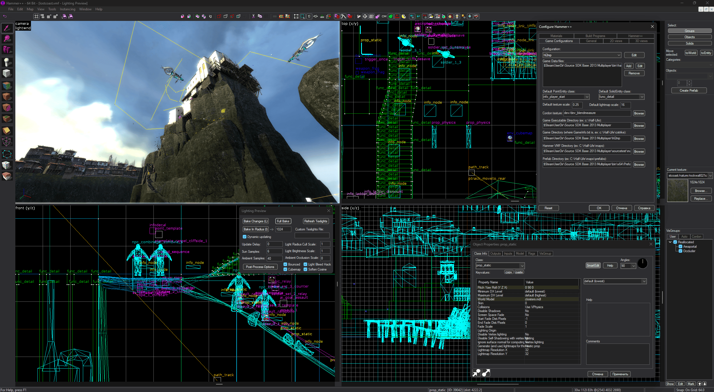

<p align="center"></p>

[English Version](README.md) | Русская версия

## Установка

**Hammer++ должен быть закрыт.**

1. Запустите **hppxdark_setup.exe**;
2. Укажите папку `bin` игры, с помощью кнопки **Browse...** или перетащите в окно;
3. Нажмите **Patch**;

## Показ


<p align="center">Hammer++ - темная тема</p>

## Настройка

Файл `hppxdark.ini` рядом с `hppxdark.dll`, в `hammerplusplus\bin`:

```ini
[DarkTheme]
Enabled=1    ; 0 - light theme / 1 - custom dark theme
```

### Палитра

Цвета тёмной темы задаются в секции `[Palette]`, как `#RRGGBB` или `R,G,B`.

*Ключи сами по себе необязательны: отсутствующие остаются по умолчанию, а нераспознанное значение не применяется (в сборке с `HPPXDARK_LOG` это отмечается в логе).*

```ini
[Palette]
Face=#2D2D30
Text=220,220,220
```

| Ключ | По умолчанию | Где используется |
|-|-|-|
| `Face` | `45,45,48` | фон панелей, диалогов, кнопок, тулбаров, разделителей |
| `Window` | `30,30,30` | фон списков, деревьев, видов; невыбранные вкладки |
| `Edit` | `37,37,38` | фон полей ввода и списков `ListBox` |
| `Text` | `220,220,220` | текст окон, меню, кнопок, подсказок |
| `GrayText` | `128,128,128` | неактивный текст, текст невыбранных вкладок |
| `Menu` | `43,43,43` | строка меню и меню |
| `MenuHot` | `62,62,66` | пункт строки меню под курсором |
| `Highlight` | `0,120,215` | выделение в списках и полях |
| `HighlightText` | `255,255,255` | текст выделения |
| `Light` | `62,62,66` | светлая кромка 3D-рамок, полосы прокрутки |
| `Hilight` | `80,80,84` | подсветка 3D-рамок |
| `Shadow` | `28,28,30` | тень 3D-рамок |
| `DarkShadow` | `15,15,15` | тёмная тень 3D-рамок |
| `Tooltip` | `50,50,52` | фон подсказок |
| `HotLight` | `86,156,214` | ссылки и подсвеченные элементы |
| `Workspace` | `28,28,28` | фон пустой MDI-области |
| `Frame` | `20,20,20` | рамки окон |
| `Border` | `100,100,104` | плоские рамки полей, вкладок, групп и строки состояния |

## Требования

- Hammer++ 8873, 32- или 64-битный: патч проверен на сборках 2013mp, 2013sp, l4d2, portal2 (x86), gmod и tf2 (x64)
- Visual Studio \>=2022
- Компонент "Разработка классических приложений на C++"
- CMake ( может входить в компонент )

## Сборка

```
cmake -B build -A x64
cmake --build build --config Release
```

На выходе `bin\hppxdark_setup.exe`, внутри обе proxy DLL: конфигурация x64 собирает x86-версию `hppxdark.dll` вложенной конфигурацией Win32. 

## Авторы

- Ficool2 - Создатель [Hammer++](https://ficool2.github.io/HammerPlusPlus-Website/) :blue_heart:
- Michael Soyka (Moon-6) - Структура, основные моменты, тесты
- Claude - Основной код патчера
